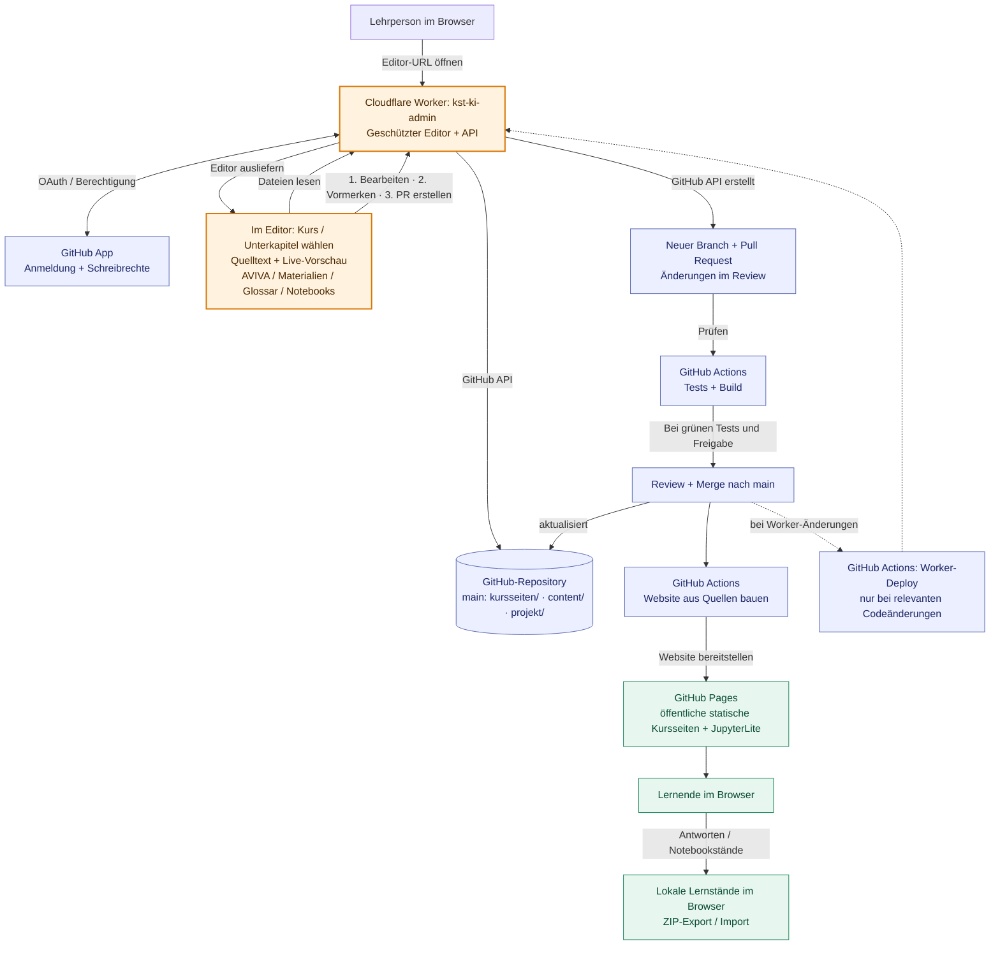

# Architektur und Redaktionskonzept

## Git-basierte Inhalte, statische Unterrichtsanwendung

Die Lernenden verwenden eine statische Website mit JupyterLite. Antworten und
Notebookstände liegen im Browser und werden als ZIP gesichert. Der optionale
Lehrpersonen-Editor verwendet einen geschützten Cloudflare Worker, um Änderungen
als GitHub-Pull-Request einzureichen; er speichert keine Schülerdaten.

## Architekturdiagramm: Editor und Veröffentlichung

Das Diagramm trennt **Redaktion mit Schreibberechtigung** (oben) von der
**veröffentlichten Kurswebsite für Lernende** (unten). Der Cloudflare Worker
ist **kein zweiter Kursserver**: Er liefert den geschützten Editor aus, übernimmt
GitHub-Login und API-Zugriffe und legt Änderungen als Pull Request an.
Die Kursseiten bleiben statisch auf GitHub Pages.



### So benutzt du den Lehrpersonen-Editor

1. **Geschützten Editor öffnen:** [kst-ki-admin.kevin-bohn.workers.dev](https://kst-ki-admin.kevin-bohn.workers.dev/) statt nur die öffentliche Pages-Seite aufrufen, und mit der GitHub App anmelden. Erforderlich sind Schreibrechte am Repository.
2. **Kurs und Bereich wählen:** In der Seitenleiste 1. oder 4. Kurzgymnasium, Themenbereich und Unterkapitel auswählen. Die Navigation lässt sich zugunsten der Split-Ansicht ausblenden.
3. **Inhalt bearbeiten:** Links Markdown/HTML oder ein Formular bearbeiten, rechts die Vorschau prüfen. Für AVIVA, Materialien und Glossar die entsprechenden Einträge verwenden; für Notebooks den Baustein «Jupyter-Notebook» bzw. «Notebook» nutzen.
4. **Notebook separat übernehmen:** Im eingebetteten JupyterLite das Notebook öffnen und bearbeiten, dann **«Notebook-Stand übernehmen»** wählen; das Notebook und die zugehörige Kapiteländerung müssen vorgemerkt werden.
5. **Änderungen vormerken:** Mit **«Änderung vormerken»** weitere Dateien sammeln; das ist **noch keine Veröffentlichung**. Danach **«Pull Request erstellen»** wählen.
6. **Review, Tests und Veröffentlichung:** Pull Request auf GitHub kontrollieren. Erst nach erfolgreichen Tests und Merge nach `main` baut GitHub Actions die öffentliche Website neu; der Worker wird **nur bei relevanten Worker-/Workflow-Änderungen** ebenfalls automatisch aktualisiert.

**Wichtig:** Schülerinnen und Schüler benötigen keinen Worker und keinen GitHub-Login.
Ihre Antworten und Notebookstände werden im Browser gespeichert und können als ZIP
exportiert/importiert werden. Der Worker speichert keine Schülerantworten.

### BOK und IRN: gemeinsames Deployment (PR #100, noch nicht veröffentlicht)

Im **offenen Feature-Branch** `feature/bok-irn-kurswege` ist eine Übersicht mit
`/bok/1-klasse/`, `/bok/4-klasse/`, `/irn/1-klasse/` und
`/irn/4-klasse/` vorbereitet. Die IRN-Seiten sind bisher Platzhalter.
Diese zusätzlichen Routen sind **noch nicht auf `main`**. Auch nach einem Merge
bleiben es **ein Repository, ein gemeinsamer GitHub-Pages-Build und ein Cloudflare
Worker**; separate vollständige Editorprofile für IRN sind noch nicht umgesetzt.

## Verbindliche Quellen

```text
kursseiten/
  manifest.json                 Bereiche, Navigation, Übersichtskarten
  <thema>/
    planung.json                eine oder mehrere Doppellektionen
    010-<kapitel>.md             Markdown/YAML oder bestehendes interaktives HTML
    materialien.md              Lehrpersonenmaterial zu diesem Thema
shared/
  course-rules.json              gemeinsame AVIVA-Phasen, Dauer und Vorlagenwerte
  course-model.js                Validierung/Vorlage für Editor und Worker
experimente/registry.json        originale Notebooks, Titel, Projektzuordnung
projekt/                        Quellvorlage, JS, CSS, Grafiken und Editor
admin-worker/                   GitHub-Authentifizierung und PR-Veröffentlichung
content/                        bearbeitbare Originalnotebooks und Python-Hilfen
worksheets/                     Arbeitsblattquellen und archivierte Materialien
lehrperson/                     gemeinsame Hinweise und Musterlösungen
scripts/                        Generatoren, Vorschau und Redaktionswerkzeuge
_build/site/projekt/             generierte HTML-Seiten und kopierte App-Assets
_build/content/                 JupyterLite-Inhalte inklusive Notebookfassungen
dist/                           vollständige veröffentlichungsfähige Website
```

Es gibt keine getrennte Behandlung der ursprünglichen zehn und neuer Lektionen.
Ein Thema kann mehrere Doppellektionen enthalten, wie die bestehende Projektphase.
Die vorhandenen Quellordner bleiben bewusst bestehen: Ein blosses Umbenennen
würde viele Notebook- und Materialpfade ändern, ohne die Redaktion zu erleichtern.

## Identität ist nicht Reihenfolge

Jede Doppellektion hat eine stabile `id`, einen `view` (Themenbereich) und eine
numerische `order`. Der Build sortiert nach `order` und erzeugt die sichtbare
Nummer. Bestehende IDs `01`–`10` und ihre URL-Anker bleiben unverändert; neue
Lektionen erhalten einen lesbaren Slug. Einfügen und Umordnen verändern keine IDs.

`materialien.md` ordnet Abschnitte über `## Doppellektion <id>` zu, nicht über die
sichtbare Nummer. Die Navigation gruppiert nach Thema und sortiert nach der ersten
zugehörigen Lektion. Zusammengehörige Lektionen sollten deshalb aufeinanderfolgen.
Didaktische Nummernverweise in frei formulierten Texten werden nicht automatisch
umgeschrieben; nach Einfügungen diese Texte redaktionell prüfen.

Bestehende Kapitel-IDs, `data-answer`, `data-journal`, `data-check`, `data-score`,
Notebooknamen und ZIP-Pfade sind Verträge mit gespeicherten Schülerständen.
Sie dürfen nicht beiläufig umbenannt werden.

## Redaktionswege

Neues Unterkapitel in einem vorhandenen Thema:

```sh
python scripts/new_chapter.py einstieg --after 030 --nummer 3a --title "Neue Perspektiven"
```

Neue Doppellektion mit eigenem Thema:

```sh
python scripts/new_lesson.py "KI im Alltag" --chapter "Anwendungen entdecken"
```

Zusätzliche Doppellektion im bestehenden Thema oder zwischen zwei Lektionen:

```sh
python scripts/new_lesson.py "Weitere Lernarten" --section lernarten --after 02
```

`--after` erwartet die stabile Lektions-ID; beim Kapitelwerkzeug dagegen das
dreistellige Dateipräfix. Beide Werkzeuge unterstützen `--dry-run`.
Der Lektionsgenerator legt Plan, erstes Kapitel und Materialabschnitt an;
bei neuen Themen ergänzt er auch das Manifest. AVIVA-Platzhalter müssen vor der
Freigabe fachlich ausgearbeitet werden. Anschliessend `make preview`.

Der [Editor](ADMIN-EDITOR.md) bearbeitet dieselben Themenpläne und Materialien.
Neue Themen werden zusammen mit Manifest und Kapitel atomar eingereicht.
Weitere Lektionen innerhalb eines bestehenden Themas können lokal mit dem
Lektionsgenerator angelegt werden; die Oberfläche hat dafür noch keinen eigenen
Anlegeknopf. Ihre Pläne sind danach im Formular bearbeitbar.

## Build und Validierung

1. `build_portal.py` liest das Manifest und die Themenpläne über
   `course_model.py`, rendert Kapitel, Navigation und Übersichtskarten.
2. `build_course.py` ergänzt AVIVA-Pläne, erzeugt Lehrpersonenübersichten,
   Materialseiten und einen vollständigen Markdown-Plan. Die Arbeitsblattquelle
   enthält nur Einleitung und Einfügemarke und wird nicht mehr überschrieben.
3. `build_portal_notebooks.py` erzeugt aus der Experimentregistrierung die
   JupyterLite-Fassungen, ohne Originalnotebooks zu verändern.
4. JupyterLite baut aus `_build/content/` nach `dist/`;
   `copy_portal.py` ergänzt die vorbereitete App.

`kurs.json` existiert nur noch als generierter Gesamtexport im Build.
AVIVA-Regeldaten und Vorlagen werden von Python, Browser und Worker gemeinsam
verwendet. Python- und JavaScript-Validierung werden gegen dieselben gültigen und
ungültigen Beispiele geprüft. Der Worker kontrolliert zusätzlich den vorgeschlagenen
Gesamtkurs und SHA-Konflikte vor dem Anlegen eines PR.

`make test` prüft Inhalte, Redaktionswerkzeuge, gespeicherte Schlüssel und
Worker-Verträge. GitHub Actions prüft zusätzlich den Editor im Browser sowie
Notebookstart, Training, Wechsel, Uploads und ZIP-Wiederherstellung.
Die Editorvorschau übernimmt Kurs-CSS und Layout; ihre Navigation liest dieselben
Bereichsmetadaten. Nur nach Änderungen an CSS oder der Quellvorlage ist
`python scripts/sync_editor_preview.py` nötig, nicht nach neuen Inhalten.
Die Vorschau führt keine Notebooks oder anderen Skripte aus und ersetzt den
echten Build nicht.
